<p align="center">
  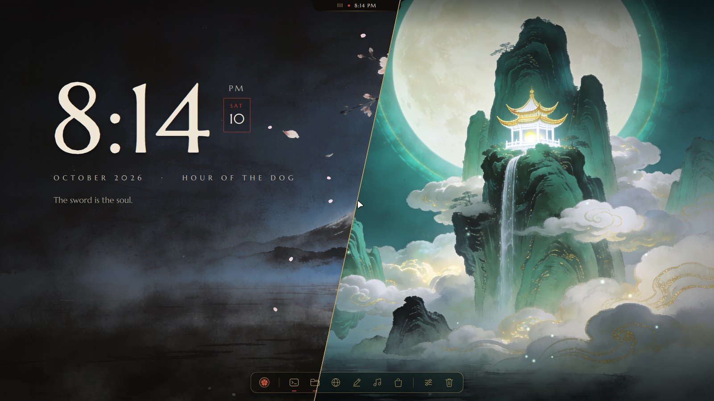
</p>

<h1 align="center">Tenka · 天下</h1>
<p align="center"><i>A design-first Linux distro with two souls: <b>Tenka</b>, the way of the blade, and <b>Tianxia</b>, the path to immortality.</i></p>

Tenka is a Debian 13 (trixie) based distro built around one idea: **everything you see should feel designed**. The boot menu, splash, login, desktop, bar, launcher, terminal, lock screen, power menu, notifications, sounds and installer all share one look, and you can switch the whole system between two complete theme packs with one command.

| | **Tenka** · Samurai | **Tianxia** · Xianxia |
|---|---|---|
| Palette | sumi ink, washi cream, vermilion, muted gold, indigo | jade, celestial white, imperial gold, mist blue, cinnabar |
| Motifs | torii, Fuji, sakura, enso, seigaiha, katana | floating peaks, xiangyun clouds, lotus, cranes, talismans |
| Type | Cinzel Decorative (wordmark), Marcellus (menus, login, lock), Inter (UI) | Cinzel Decorative (wordmark), Marcellus (menus, login, lock), Inter (UI) |
| Motion | sharp, decisive, like a blade draw | weightless, drifting, like mist and qi |
| Sound | koto plucks in the In scale, shakuhachi breath | guzheng glissando, temple bell |
| Wording | "The blade rests." · Guard / Retreat / Rest / Return / Sheathe | "In seclusion." · Seclusion / Descend / Meditate / Rebirth / Ascend |

All text stays in English. Only the aesthetic is Japanese or Chinese.

## Screenshots

> Boot screens are captured from the ISO in QEMU. Desktop shots are real renders of the shell running on a Wayland compositor with software rendering (no GPU). More in [`docs/screenshots`](docs/screenshots).

| | Tenka | Tianxia |
|---|---|---|
| Boot menu | 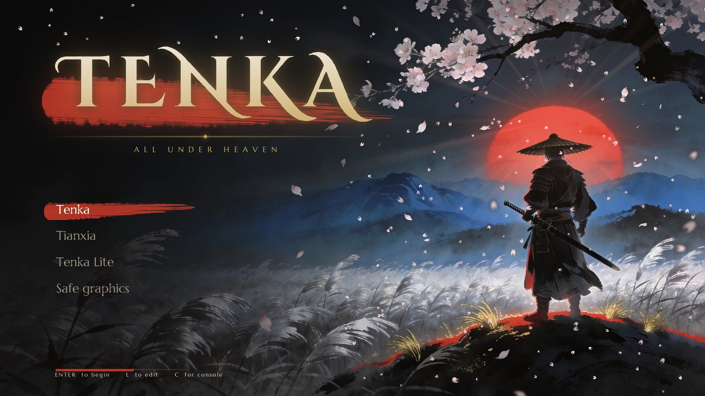 | 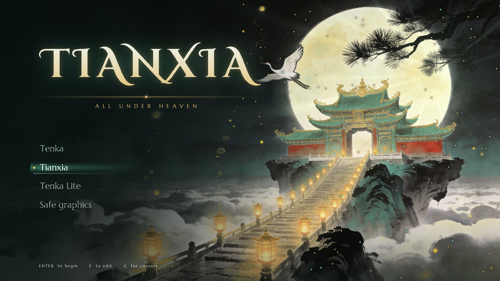 |
| Desktop | 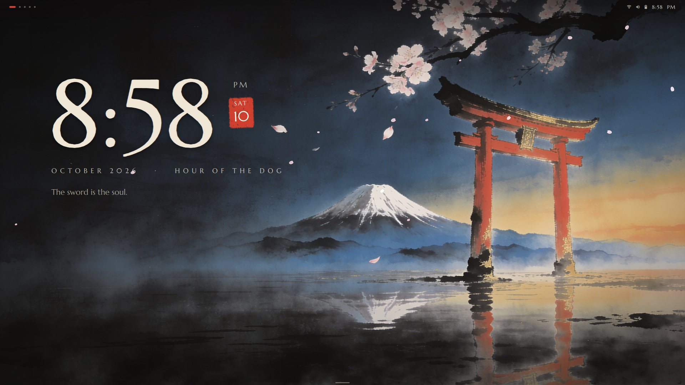 | 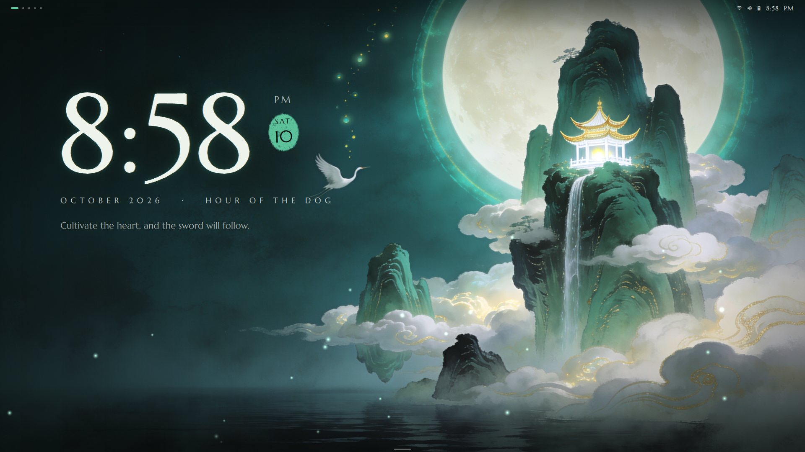 |
| Cards + dock | 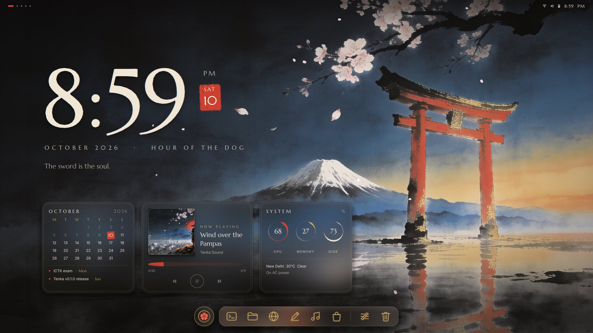 | 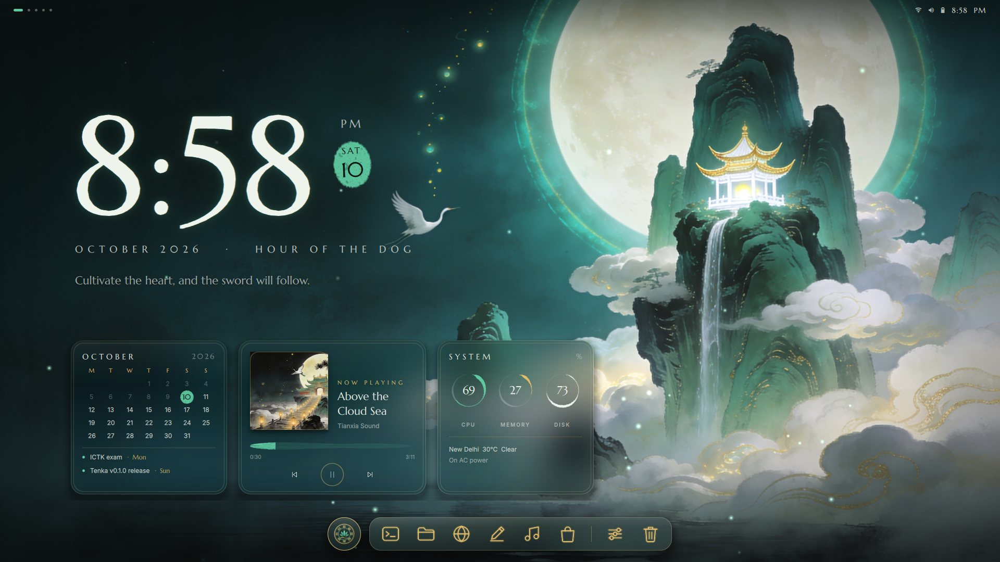 |
| Launcher | 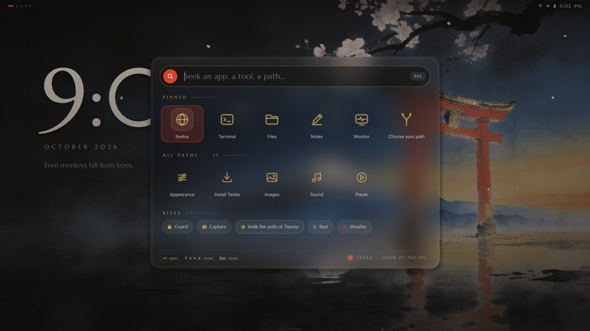 | 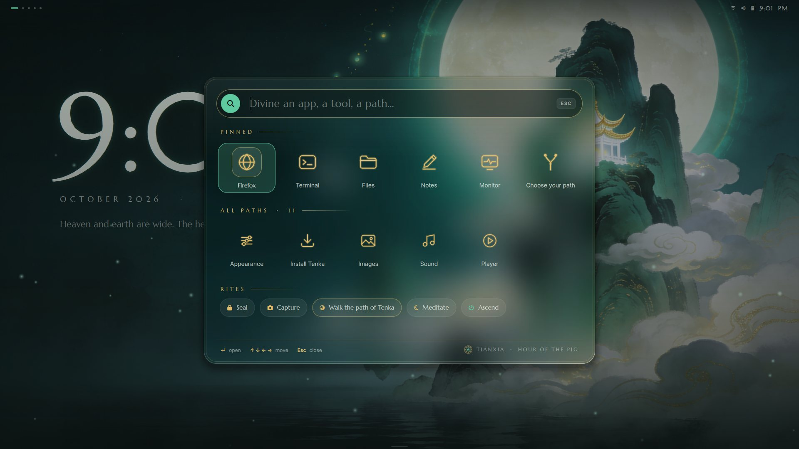 |
| Control center | 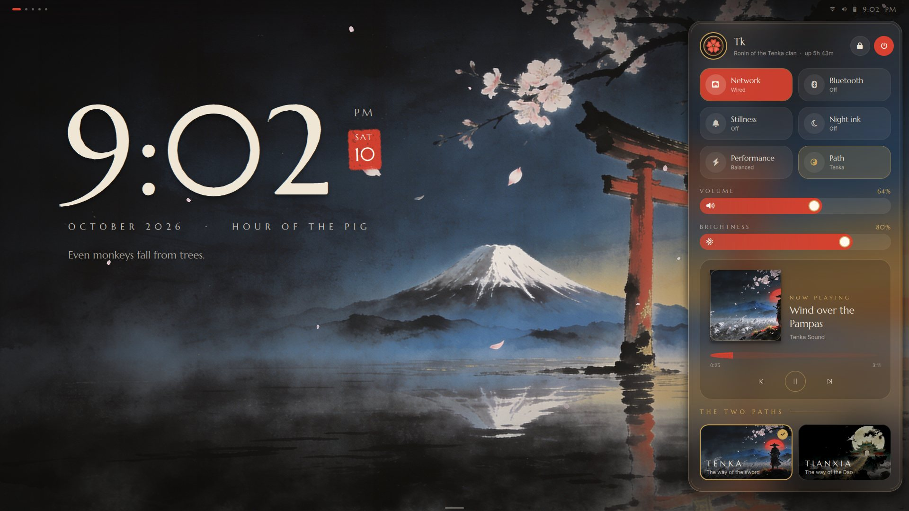 | 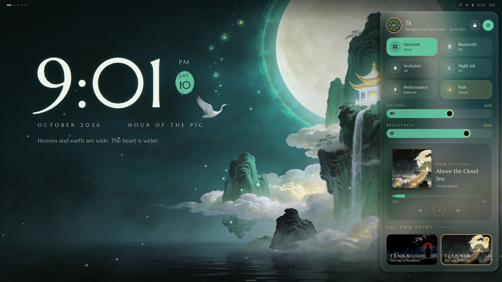 |
| Lock screen | 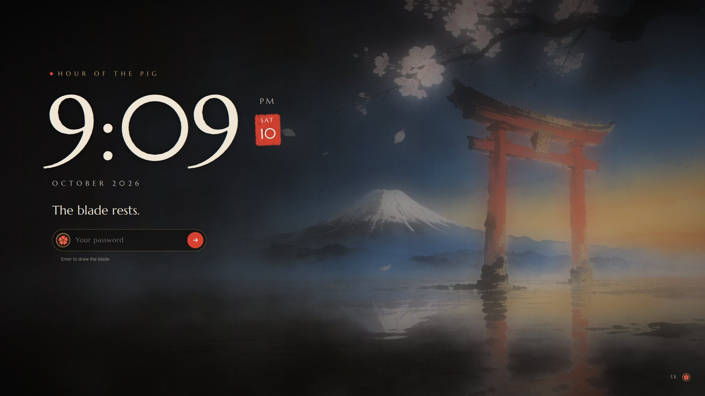 | 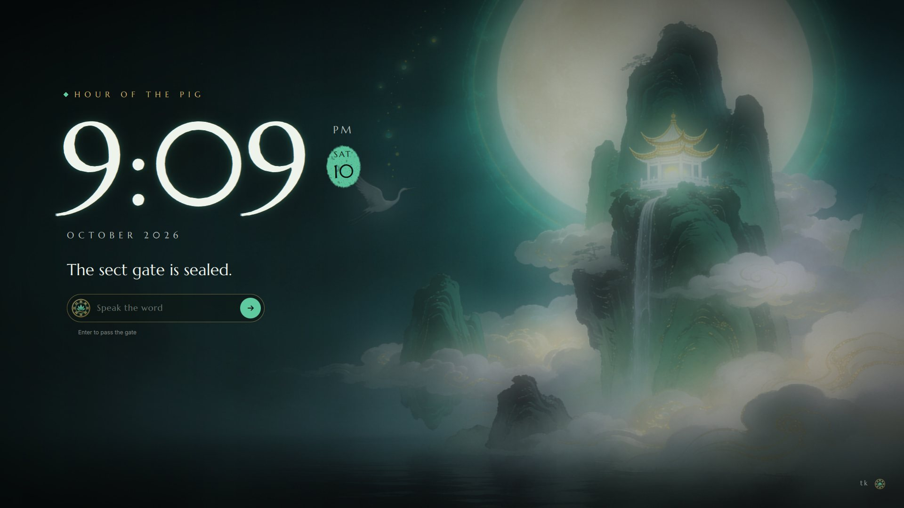 |

<p align="center">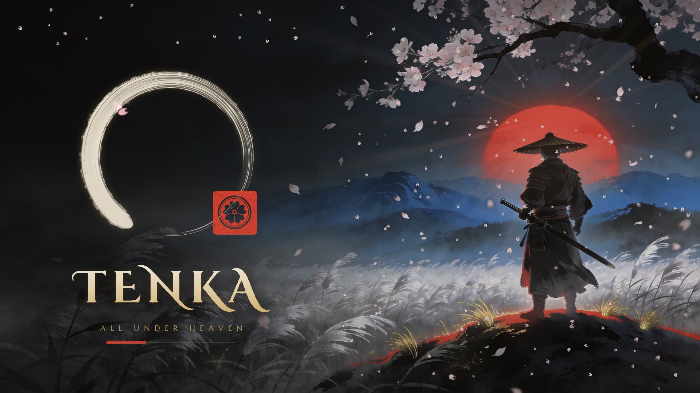 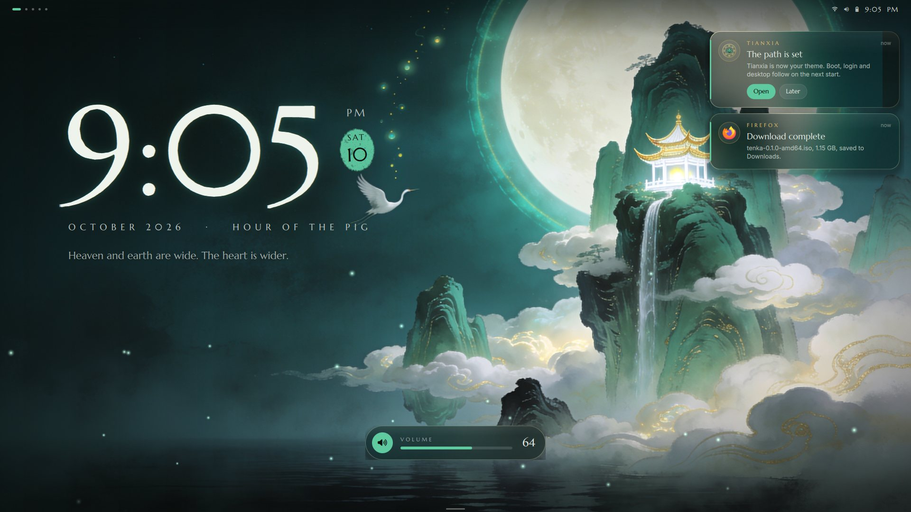 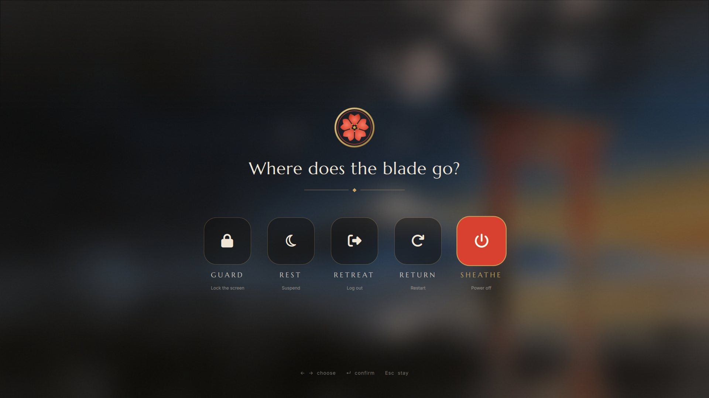</p>

## What's inside

**Two sessions, picked at the login screen**

- **Tenka**: the flagship. Hyprland 0.55 (Lua config) with rounded glass windows, layered blur, soft shadows and per-theme bezier motion, and **a desktop shell written from scratch in Quickshell** ([`shell/quickshell/tenka`](shell/quickshell/tenka)). Nothing in it is stock:
  - **The desk**, minimal by default: purpose-painted art, a huge Marcellus clock, one hand-stamped seal with the weekday and day, the month with the old double-hour ("Hour of the Dog"), and a proverb that changes each hour. A few sakura petals fall (Tenka) or qi motes rise (Tianxia).
  - **Cards on demand**: click the clock, press <kbd>Super</kbd>+<kbd>D</kbd> or touch the bottom edge, and three frosted cards slide up: the month (today under an ink seal, your next events from `~/.config/tenka/desk.json`), now playing (any MPRIS player, the progress drawn as a dry brush stroke) and the machine (brush-enso gauges for CPU, memory and disk, live weather, power).
  - **A bar that is almost nothing**: five workspace dots, the window title, three line glyphs and the time.
  - **An auto-hiding dock** of hand-drawn gold line icons, with the crest apart as the launcher.
  - **Launcher** with search, pinned paths and "rites" (lock, capture, switch theme, rest, power off); **control center** with toggles, brush sliders, now playing and *The Two Paths* theme switcher; **notifications** that spring in with action pills and a koto/guzheng chime; a **volume/brightness OSD**; a full-screen **power menu** of five seals; and a **lock screen** that is the desktop's title card (Wayland session lock + PAM; hyprlock is the fallback).
  - All glass frosts the real art. On Hyprland the compositor blurs; in performance mode or other compositors the shell frosts from a pre-blurred copy of the wallpaper, so it costs nothing on software rendering.
- **Tenka Lite**: the same art on a lighter engine, built on XFCE 4.20 for older PCs and VMs without 3D. The desk title card (clock, seal, month, proverb) is drawn by conky, the top bar is bare, the dock auto-hides, and the same hand-drawn icons sit on top of Papirus (`Tenka-Samurai` / `Tenka-Xianxia` icon themes). It also has per-theme xfwm4 decorations, a themed Whisker menu, themed notifications and the same sounds.

**Hardware aware.** At boot, Tenka checks for real 3D acceleration and at least 3.5 GB of RAM. If either is missing, it starts Tenka Lite and says so in the welcome app. You can always pick either session at the login screen.

**Performance mode.** `tenka-perf on` (or <kbd>Super</kbd>+<kbd>Shift</kbd>+<kbd>P</kbd>, or the checkbox in the welcome app) turns off blur, shadows and animations. Every piece of art stays.

**A boot that plays like a title screen.** The GRUB menu is a title card: purpose-painted key art (a ronin under a blood-red sun; a jade sky palace under the moon), the wordmark baked in with glow and ink bleed, a gold hairline and a tracked tagline, and Marcellus menu entries floating over an ink falloff. The selected entry gets a vermilion dry-brush stroke (or a jade glow with a gold bead), and the countdown is a single glowing line. Plymouth continues the same scene: mist drifts, sakura fall (or qi motes rise), a big enso paints itself (a jade formation ring draws itself for Tianxia), the seal stamps in, and boot progress is a brush line. There is no text, and its last frame is the login screen's background, so the hand-off to SDDM is seamless.

**Themed everywhere:** GRUB boot menu (BIOS and UEFI, 1080p and 4K assets), Plymouth splash, the SDDM login screen (clock, date with the old double-hour, frosted card), the Calamares installer (branding and slides), GTK3/4, Qt (qt6ct palettes), Bibata cursors, hand-drawn app icons over Papirus, and os-release (the display name follows the theme).

**Lean:** zram swap (zstd, 50% of RAM), no indexers or background updaters, Firefox ESR with quiet defaults, no office suite in the ISO.

## Switching themes

```sh
tenka-theme samurai     # or: tenka-theme tenka
tenka-theme xianxia     # or: tenka-theme tianxia
```

Or press <kbd>Super</kbd>+<kbd>T</kbd>, or open **Choose your path** from the launcher. The desktop switches live: art, colours, borders, motion, the whole shell, terminal, lock screen and sounds. The boot menu, splash and login screen follow on the next boot. On the ISO's boot menu you can also start straight into **Tianxia**.

## Keys (Hyprland)

| Keys | Action |
|---|---|
| <kbd>Super</kbd>+<kbd>Space</kbd> | launcher |
| <kbd>Super</kbd>+<kbd>D</kbd> | desk cards + dock |
| <kbd>Super</kbd>+<kbd>A</kbd> | control center |
| <kbd>Super</kbd>+<kbd>Return</kbd> | terminal (kitty) |
| <kbd>Super</kbd>+<kbd>E</kbd> / <kbd>B</kbd> | files / browser |
| <kbd>Super</kbd>+<kbd>Q</kbd> / <kbd>F</kbd> / <kbd>V</kbd> | close / fullscreen / float |
| <kbd>Super</kbd>+<kbd>T</kbd> | switch theme |
| <kbd>Super</kbd>+<kbd>W</kbd> | next wallpaper (cross-fade) |
| <kbd>Super</kbd>+<kbd>L</kbd> | lock |
| <kbd>Super</kbd>+<kbd>Escape</kbd> | power menu |
| <kbd>Super</kbd>+<kbd>Shift</kbd>+<kbd>V</kbd> | clipboard history |
| <kbd>Super</kbd>+<kbd>Shift</kbd>+<kbd>P</kbd> | performance mode |
| <kbd>Print</kbd> / <kbd>Shift</kbd>+<kbd>Print</kbd> | screenshot area / screen |

## Captured in a VM

> Real screenshots of the v0.1.0 ISO booted in QEMU with **no GPU** (software rendering, emulated CPU). Hyprland + the Tenka shell with real compositor blur, and Tenka Lite (XFCE), which Tenka picks by itself at boot on machines without 3D or with little RAM. Tenka Lite idles at about **830 MB** of RAM in the live session.

| | Tenka | Tianxia |
|---|---|---|
| Hyprland desktop | 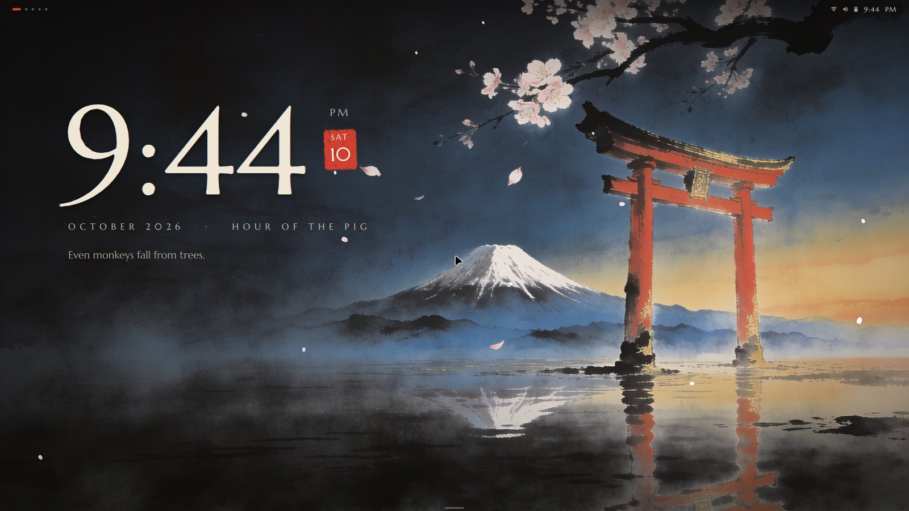 | 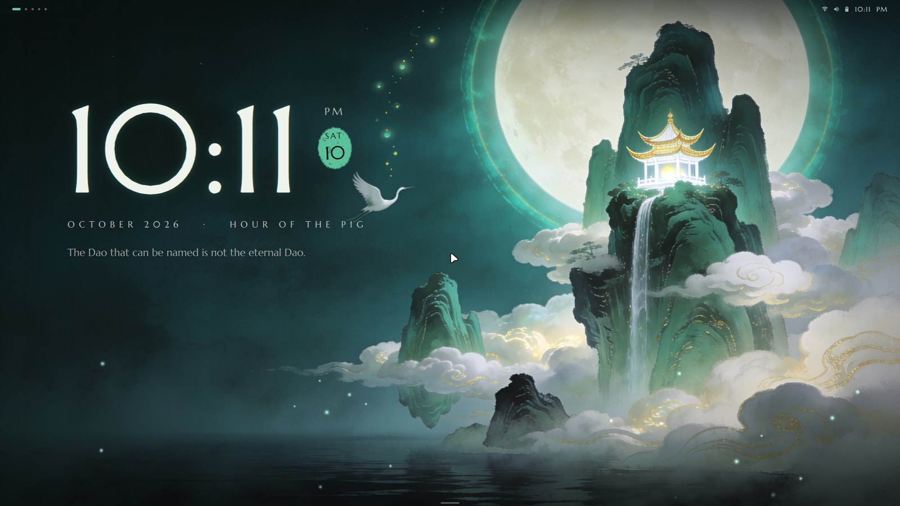 |
| Launcher | 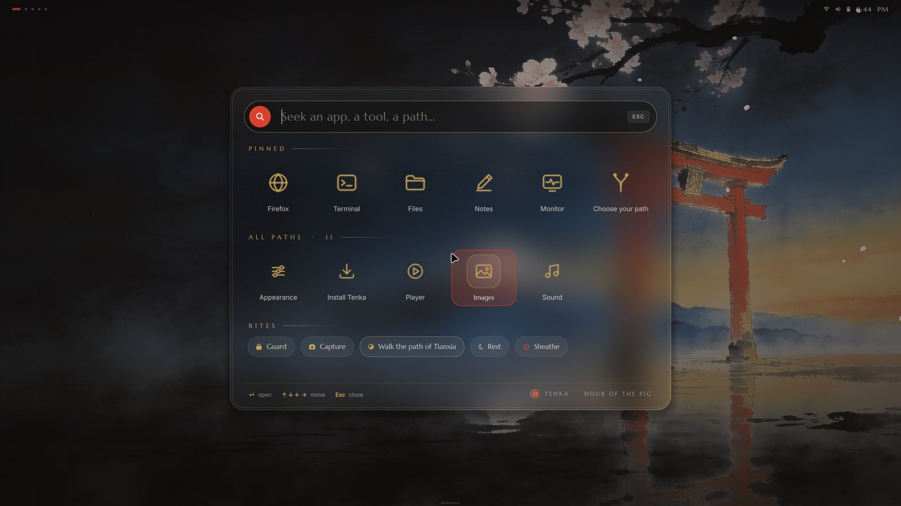 | 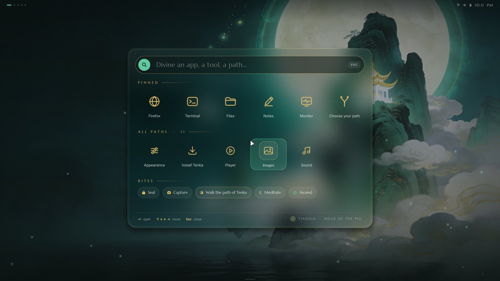 |
| Control center · Lock | 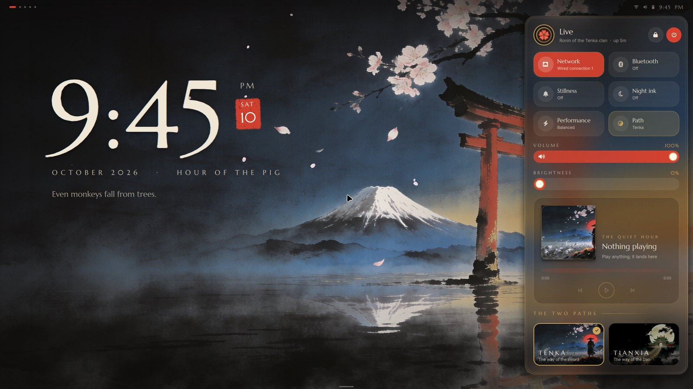 | 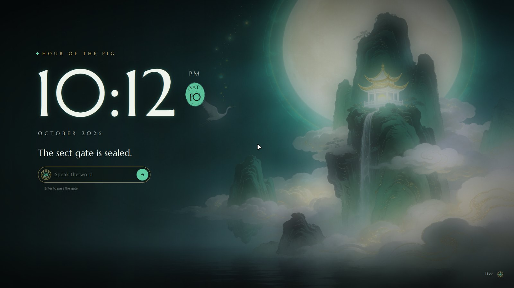 |
| Tenka Lite (XFCE) | 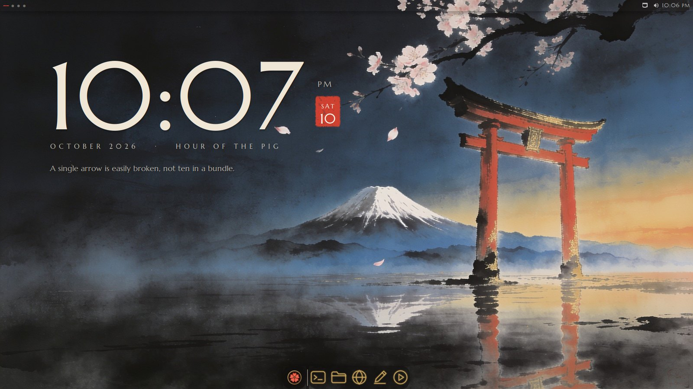 | 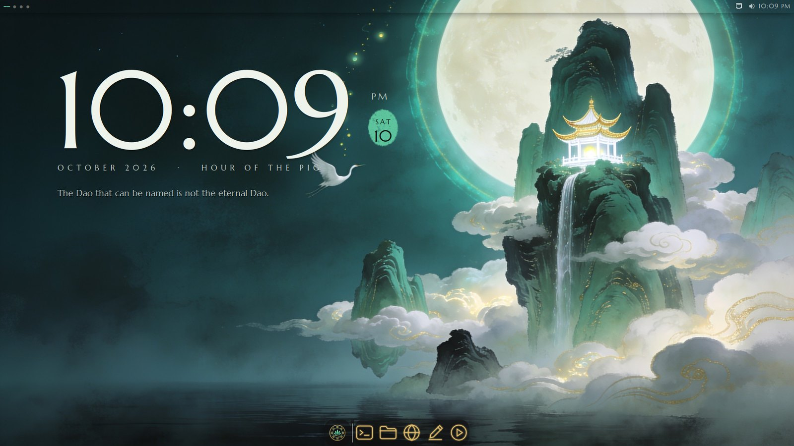 |

## System requirements

| | Minimum (Tenka Lite) | Recommended (Tenka, Hyprland) |
|---|---|---|
| CPU | 2 cores, x86-64 | 4 cores |
| RAM | 2 GB | 4 GB or more |
| Graphics | anything (software rendering works) | 3D acceleration (Intel / AMD / NVIDIA, or a VM with 3D enabled) |
| Disk | 20 GB | 30 GB |
| Firmware | BIOS or UEFI | UEFI |

## Download

Grab the ISO from **[Releases](https://github.com/naman-sharma12345/tenka/releases)**. It's built by GitHub Actions from this repo.

## Run it in a VM

**VirtualBox**
1. New VM: type *Linux*, version *Debian (64-bit)*, **4 GB RAM** (2 GB minimum), 2–4 CPUs, a 30 GB disk.
2. Settings → System → enable **EFI**.
3. Settings → Display → Graphics Controller **VMSVGA**, Video Memory **128 MB**, tick **Enable 3D Acceleration**.
4. Attach the ISO, boot, and choose **Tenka** (or **Tianxia**). If the screen stays black, reboot and pick **Tenka Lite** in the boot menu.

**VMware Workstation / Player**
1. New VM → *Debian 12.x 64-bit* (or later), 4 GB RAM, 30 GB disk.
2. VM Settings → Display → **Accelerate 3D graphics** on. Options → Advanced → Firmware **UEFI**.
3. Boot the ISO.

**QEMU / virt-manager** (best with 3D):
```sh
qemu-system-x86_64 -enable-kvm -m 4096 -smp 4 -cpu host -machine q35 \
  -bios /usr/share/ovmf/OVMF.fd -device virtio-vga-gl -display gtk,gl=on \
  -cdrom tenka-0.1.0-amd64.hybrid.iso
```
or `make run`. Without `virtio-vga-gl` (no 3D), Tenka starts in Lite automatically.

Live session user: `live`, password `live`. To install, run **Install Tenka** from the launcher or menu.

## Build it yourself

You need a Debian 13 (or newer) machine or container with root.

```sh
sudo make deps     # live-build, debootstrap, xorriso, grub, pillow, …
sudo make iso      # → build/live/tenka-0.1.0-amd64.hybrid.iso
```

`make themes` regenerates every themed file from the palettes in `scripts/gen-themes.py`, so change a colour once and the bar, terminal, launcher, GTK, Qt, lock screen and the rest all follow. Branding lives in `distro.conf`.

### Layout

```
distro.conf                  name, id, version
scripts/gen-themes.py        palettes + wording → user configs per theme (Hyprland Lua, waybar, fuzzel, mako, kitty, …)
scripts/gen-lite.py          GTK theme, xfwm4 decorations, notifyd theme, terminal colours
scripts/tenka_art.py         shared procedural art: dry-brush strokes, ink-bled wordmarks, light rays, petals, the title-card grade
scripts/gen-boot.py          GRUB title-card menus (1080p + 4K) and the live ISO menu
scripts/gen-plymouth.py      the animated splash (and the login screen's matching background)
scripts/gen-system.py        SDDM and Calamares themes; runs gen-boot.py and gen-plymouth.py
scripts/sddm/Main.qml        the login screen
scripts/gen-shell.py         per-theme words, colours and art for the shell
shell/quickshell/tenka/      the Tenka shell: desk, cards, bar, dock, launcher, control center, notifications, OSD, power, lock
themes/<samurai|xianxia>/    art: wallpapers, crest, splash frames, sounds, icons + generated home/ overlay
live/                        live-build config (auto/, package lists, hooks, includes.chroot, bootloaders)
.github/workflows/           CI: builds the ISO in a Debian 13 container and attaches it to the release
```

## Roadmap

- [ ] Tested on real hardware (Intel/AMD iGPU, NVIDIA) and VirtualBox / VMware with 3D
- [ ] Papirus folder tints per theme
- [ ] Settings page inside the control center (Wi-Fi and Bluetooth pickers)
- [ ] Kvantum themes drawn per pack
- [ ] swww-style animated wallpaper transitions (wipes and grows)
- [ ] Third theme pack
- [ ] Secure Boot (signed shim + GRUB)
- [ ] Settings app for themes, performance mode and wallpapers

## Credits

Built on Debian, Hyprland, Quickshell, kitty, XFCE, conky, SDDM, Plymouth, GRUB and Calamares. Fonts: Marcellus, Cinzel Decorative, Inter, JetBrains Mono, Cinzel, Cormorant Garamond, Shippori Mincho B1 (all SIL OFL), Symbols Nerd Font (MIT). Icons: Papirus (GPL-3). Cursors: Bibata (GPL-3). Wallpapers, crests, splash animations, sounds and icons were made for this project; see `themes/*/ATTRIBUTION.md`.

MIT licensed. See [LICENSE](LICENSE).
